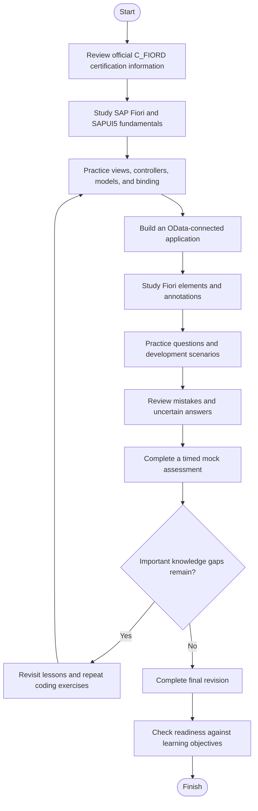
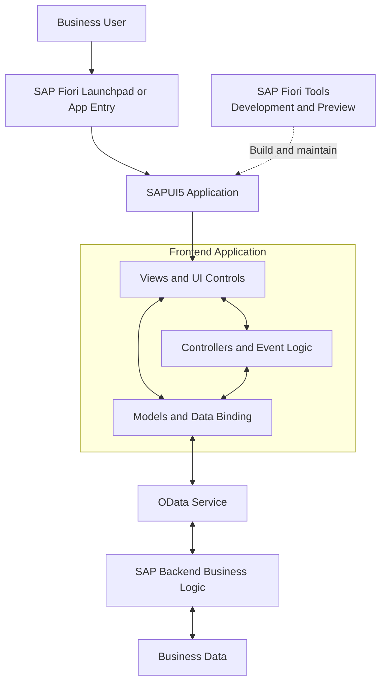
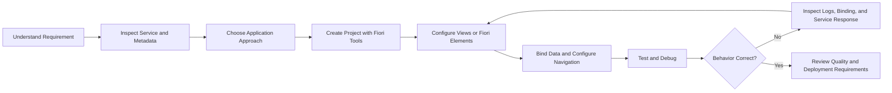
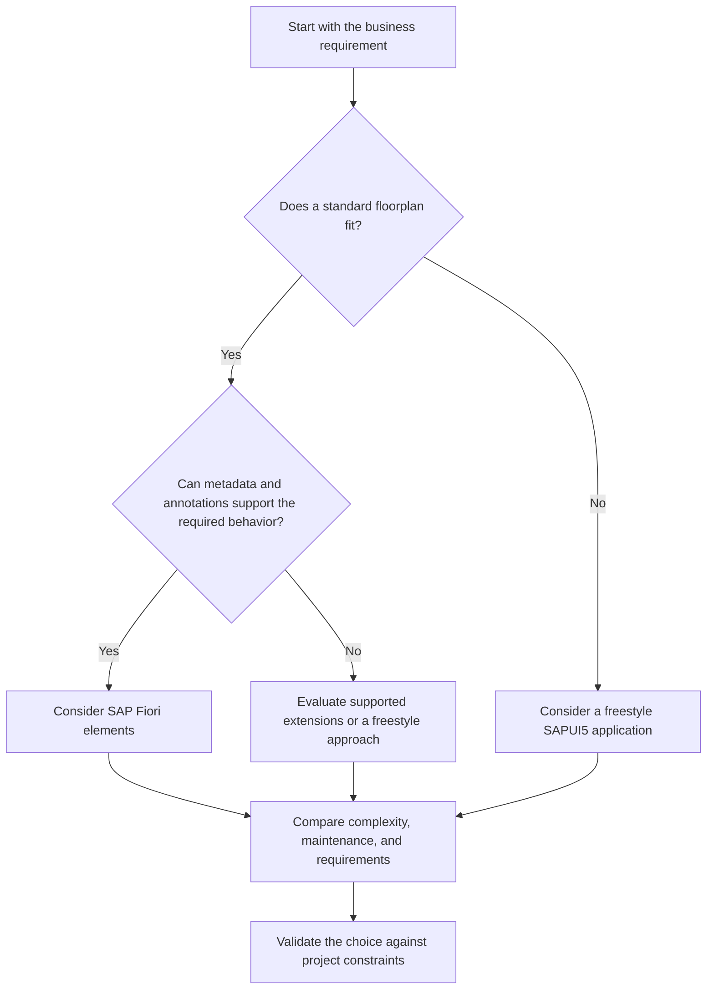
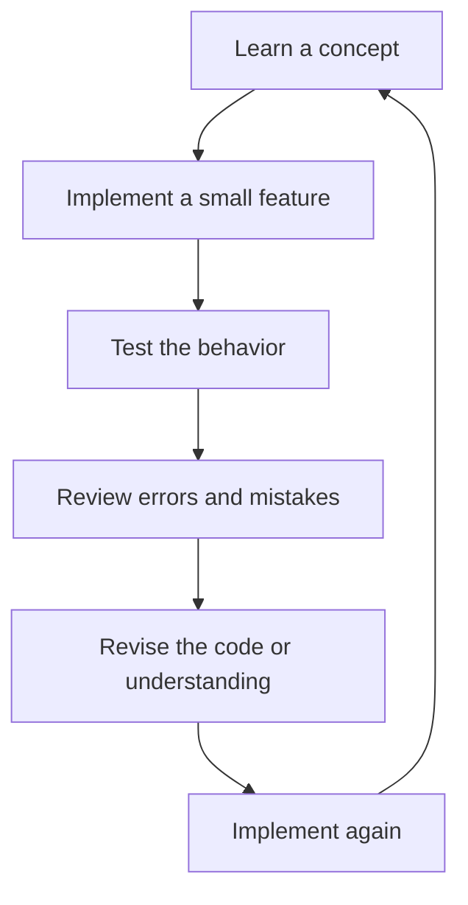
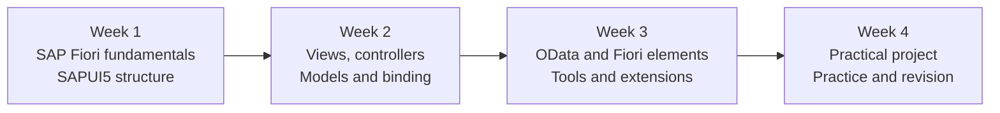

# SAP Fiori Application Developer (C_FIORD) — Study Guide

A practical study guide for the **SAP Certified – SAP Fiori Application Developer (C_FIORD)** certification. This repository organizes key SAP Fiori and SAPUI5 development concepts into a structured learning path, with architecture diagrams, development workflows, practice scenarios, and hands-on exercises.

The focus is on understanding how SAP Fiori applications are designed, how SAPUI5 connects user interfaces to data, how SAP Fiori elements uses metadata and annotations, and how developers build, test, and extend applications.

**Supplementary preparation resource:** [CertsGate — SAP C_FIORD](https://certsgate.com/exams/sap/c_fiord)

---

## Table of Contents

- [About the Certification](#about-the-certification)
- [Who Should Prepare?](#who-should-prepare)
- [Exam Information](#exam-information)
- [Core Technical Knowledge Areas](#core-technical-knowledge-areas)
- [SAP Fiori and SAPUI5 Fundamentals](#sap-fiori-and-sapui5-fundamentals)
- [Conceptual Skills Map](#conceptual-skills-map)
- [Preparation Flowchart](#preparation-flowchart)
- [SAP Fiori Application Architecture](#sap-fiori-application-architecture)
- [Application Development Workflow](#application-development-workflow)
- [Circular Study and Revision Cycle](#circular-study-and-revision-cycle)
- [Step-by-Step C_FIORD Preparation](#step-by-step-c_fiord-preparation)
- [Suggested Study Roadmap](#suggested-study-roadmap)
- [Practice Questions and Mock Tests](#practice-questions-and-mock-tests)
- [Hands-On Development Projects](#hands-on-development-projects)
- [Common Preparation Mistakes](#common-preparation-mistakes)
- [Career Relevance](#career-relevance)
- [Frequently Asked Questions](#frequently-asked-questions)
- [Official and Additional Learning Resources](#official-and-additional-learning-resources)
- [About CertsGate](#about-certsgate)

---

## About the Certification

The **SAP Certified – SAP Fiori Application Developer** certification is intended for developers working with SAP Fiori application development and related frontend technologies.

SAP describes this certification as validating the skills needed for the SAP Fiori application development frontend developer profile. The certification builds on foundational knowledge gained through SAP learning and is intended to be supported by practical development experience.

SAP Fiori is SAP's design system and user experience approach for business applications. SAPUI5 is a JavaScript-based UI development framework used to build responsive web applications. SAP Fiori elements provides predefined application patterns and templates that can reduce the amount of custom interface code needed for common business scenarios.

For example, a developer might build an application that displays business records in a list, lets users filter and select an item, and opens a detail page. Depending on the requirements, the developer might use SAP Fiori elements with OData services and annotations, or create a more customized SAPUI5 application using views, controllers, models, and controls.

This C_FIORD study guide focuses on the concepts and development workflows that help learners understand these approaches.

**Official certification page:**  
https://learning.sap.com/certifications/sap-certified-associate-sap-fiori-application-developer-1

## Who Should Prepare?

This study guide is useful for:

- Frontend developers working with SAP business applications.
- SAPUI5 developers building enterprise web interfaces.
- SAP Fiori developers creating or extending application experiences.
- SAP consultants moving into application development.
- Developers learning metadata-driven application development with SAP Fiori elements.
- Technical professionals preparing to work with OData-based SAP applications.

A basic understanding of JavaScript, web application development, and data-driven interfaces is helpful. Experience with SAP systems, OData, XML views, and model-based application development can make the more advanced topics easier to understand.

Review the official SAP learning resources to identify the recommended prerequisites for your current skill level.

---

## Exam Information

The following details are listed on SAP's certification page reviewed for this guide.

| Item | Information |
|---|---|
| Certification | SAP Certified – SAP Fiori Application Developer |
| Exam code | C_FIORD |
| Certification provider | SAP |
| Assessment type | Scenario Based Assessment |
| Duration | 2 hours |
| Published pass score | 60% |
| Intended profile | Frontend Developer |
| Recommended foundation | SAP Fiori and SAPUI5 development knowledge |

CertsGate lists the exam version as `C_FIORD_2601`, while SAP's certification page identifies the exam as `C_FIORD`. Confirm the current version and assessment instructions directly with SAP before scheduling your exam.

**Official source:** [SAP C_FIORD certification](https://learning.sap.com/certifications/sap-certified-associate-sap-fiori-application-developer-1)

SAP currently lists one scenario-based assessment with a duration of two hours and a 60% passing score. Question count and detailed exam-domain weightings are not included here because they were not verified from the official information used for this guide.

Certification requirements can change. Check the official page for current registration details, technical requirements, assessment policies, and preparation recommendations.

---

## Core Technical Knowledge Areas

Use the following topics as a practical learning checklist. This is an independent study overview, not a reproduction of SAP's official exam blueprint or an assertion of exam-domain weightings.

| Knowledge area | What to understand |
|---|---|
| SAP Fiori fundamentals | Design principles, responsive interfaces, navigation, and application patterns |
| SAPUI5 framework | Framework structure, controls, application initialization, and lifecycle |
| MVC architecture | Separation of models, views, and controllers |
| Views and controllers | XML views, controller logic, event handling, and reusable components |
| Models and data binding | JSON models, OData models, property binding, and aggregation binding |
| OData services | Reading and updating business data through supported service operations |
| SAP Fiori elements | Metadata-driven development, annotations, templates, and floorplans |
| SAP Fiori tools | Project creation, guided development, local preview, and development workflow |
| Navigation and routing | Route configuration, targets, navigation parameters, and application flow |
| Reuse and extension | Fragments, components, extension points, and supported customization patterns |
| Testing and quality | Debugging, error handling, maintainability, and practical verification |
| Responsive and accessible UI | Device adaptation, usability, and accessibility considerations |

The purpose of this checklist is to organize study and practice. Use SAP's official learning journey and current documentation to establish the authoritative scope for your preparation.

## SAP Fiori and SAPUI5 Fundamentals

Before building applications, understand how the technologies fit together.

- **SAP Fiori** describes the user experience approach and design language for SAP business applications.
- **SAPUI5** provides controls, models, data binding, views, and application infrastructure for developing web-based user interfaces.
- **SAP Fiori elements** provides predefined application patterns that use service metadata and annotations to generate common UI structures.
- **OData** provides a standardized way for applications to access and interact with data exposed by compatible services.
- **SAP Fiori tools** supports the development workflow through project templates, guided development, and related tooling.

### SAPUI5 versus SAP Fiori elements

| Aspect | SAPUI5 freestyle application | SAP Fiori elements application |
|---|---|---|
| Main approach | Developer builds the UI and application behavior | UI is generated from metadata, annotations, and templates |
| Customization | Greater direct control over the interface | Configuration and supported extension mechanisms |
| Typical building blocks | Controls, views, controllers, models, and components | Floorplans, annotations, manifest configuration, and supported extensions |
| Suitable when | Requirements need custom UI behavior or layouts | Requirements fit established business application patterns |
| Important consideration | More UI implementation decisions may be required | Features depend on the chosen template, service metadata, and supported extension options |

Neither approach is automatically the right choice for every project. Understand the business requirement, existing service, available floorplans, and expected level of customization before choosing an implementation approach.

Official overview: [SAPUI5 and SAP Fiori elements documentation](https://help.sap.com/docs/SAPUI5)

---

## Conceptual Skills Map

SAP's public certification page does not provide a complete percentage-weighted exam-domain breakdown in the information used for this guide. The diagram below groups relevant study themes without assigning numerical weights.

```mermaid
flowchart TD
    A["C_FIORD Preparation"] --> B["SAP Fiori Fundamentals"]
    A --> C["SAPUI5 Development"]
    A --> D["Data Integration"]
    A --> E["Fiori Elements"]
    A --> F["Quality and Delivery"]

    B --> B1["Design and responsiveness"]
    B --> B2["Navigation and application patterns"]

    C --> C1["Views and controllers"]
    C --> C2["Controls and fragments"]
    C --> C3["Models and data binding"]
    C --> C4["Routing and components"]

    D --> D1["OData services"]
    D --> D2["Metadata and service responses"]
    D --> D3["Error handling"]

    E --> E1["Annotations"]
    E --> E2["List Report and Object Page"]
    E --> E3["Configuration and extensions"]

    F --> F1["Debugging and testing"]
    F --> F2["SAP Fiori tools"]
    F --> F3["Maintainability and accessibility"]
```

Use this map to organize revision and identify topics that need more hands-on work. It is a study aid, not an official SAP exam weighting chart.

---

## Preparation Flowchart

C_FIORD preparation should combine official learning, code-level practice, scenario questions, and review of weak areas.

The decision point matters. If you can recognize an API or choose an answer but cannot explain the underlying application behavior, return to the relevant topic and practice it again.

---

## SAP Fiori Application Architecture

The following diagram presents a simplified, conceptual architecture for a SAPUI5 application that consumes an OData service. Actual deployments vary depending on the SAP backend, service implementation, authentication, hosting environment, and application type.

### What each component does

- **SAP Fiori launchpad or app entry:** Provides the environment through which users access the application, depending on deployment.
- **Views and UI controls:** Display information and receive user interactions.
- **Controllers:** Handle events and coordinate application behavior.
- **Models:** Hold or expose application data and provide the basis for data binding.
- **OData service:** Exposes data and operations through a service interface.
- **Backend business logic:** Applies the rules and processing required by the business application.
- **Business data:** Represents the records and information used by the application.
- **SAP Fiori tools:** Helps developers create, configure, preview, and maintain application projects.

The diagram is conceptual. It should not be interpreted as a required physical deployment topology for every SAP Fiori application.

---

## Application Development Workflow

SAP Fiori development usually involves more than writing a view. Developers need to understand the service contract, prepare the UI, connect the data, configure navigation, test the application, and address errors.

### Freestyle SAPUI5 or SAP Fiori elements?

Use the following decision tree as a starting point when considering an implementation approach.

The correct approach depends on the service, required interaction, supported floorplans, extension options, and maintenance expectations. Check the official documentation for the SAPUI5 and OData versions relevant to your application.

---

## Circular Study and Revision Cycle

Learning application development is iterative. Read a concept, implement it, test the result, review what failed, and repeat the exercise until the behavior is clear.

For example, when learning data binding, do not stop after reading an example. Create a view, bind a control to a model property, change the property, and observe how the UI responds. Then repeat the task with a different binding type.

---

## Step-by-Step C_FIORD Preparation

### Step 1: Review the official certification page

Start with the [SAP C_FIORD certification page](https://learning.sap.com/certifications/sap-certified-associate-sap-fiori-application-developer-1).

Confirm the current assessment duration, pass score, assessment format, and recommended preparation resources. Record the certification version you plan to take.

### Step 2: Strengthen SAP Fiori fundamentals

Learn the purpose of SAP Fiori, the role of SAPUI5, and the principles behind responsive business applications.

Study application navigation, common UI patterns, and how an application is accessed by end users. Understand the difference between the user experience, the frontend framework, and the backend services that provide business functionality.

A useful starting point is SAP's [Learning the Basics of SAP Fiori](https://learning.sap.com/courses/learning-the-basics-of-sap-fiori) course.

### Step 3: Practice SAPUI5 views and controllers

Learn how XML views describe the UI and how controllers handle user interactions. Understand event handlers, view lifecycle concepts, components, and fragments.

Practice a small application with a page title, a data table or list, and a button that triggers an action. Keep the view structure and event logic easy to follow.

Official learning resource: [Developing UIs with SAPUI5](https://learning.sap.com/courses/developing-uis-with-sapui5-1).

### Step 4: Understand models and data binding

Models provide application data, while data binding connects that data to UI controls.

Study common binding patterns, including property binding and aggregation binding. Learn how to access model data, update the UI, and troubleshoot cases where a control displays no data.

Practice with a small JSON model first, then explore OData model behavior and service responses.

### Step 5: Learn OData integration

Understand how an application consumes an OData service and how service metadata describes entities, properties, and available operations.

Practice inspecting a service response and checking whether the expected data reaches the model. When something fails, examine the request, response, binding path, and relevant error messages instead of changing unrelated UI code.

Do not assume that all OData versions or services support the same features. Consult the documentation for the specific service and application configuration.

### Step 6: Study SAP Fiori elements

Learn how annotations and metadata influence the generated user interface. Become familiar with common floorplans such as List Report and Object Page, and understand when configuration is sufficient versus when a supported extension may be needed.

SAP's [Developing SAPUI5 Applications](https://learning.sap.com/learning-journeys/developing-sapui5-applications) learning journey covers SAP Fiori elements architecture, templates, data binding, views, controllers, and extension concepts.

### Step 7: Practice SAP Fiori tools

Become familiar with creating a project, reviewing the generated structure, configuring application settings, running a preview, and debugging issues.

SAP Fiori tools are available through supported development environments, including SAP Business Application Studio and Visual Studio Code. The available workflow depends on the environment and project type.

Official reference: [SAPUI5 documentation](https://help.sap.com/docs/SAPUI5).

### Step 8: Practice debugging and quality checks

Test application behavior with valid data, missing values, failed requests, and unexpected responses.

Check that controls display the intended values, navigation works as expected, and error messages are understandable. Review maintainability, accessibility, and responsive behavior as part of the development process.

### Step 9: Answer practice questions

Use practice questions after studying a topic. For every incorrect or uncertain answer, identify the underlying concept and revisit the relevant official lesson.

For supplementary preparation, explore [CertsGate's C_FIORD page](https://certsgate.com/exams/sap/c_fiord). Treat third-party questions as independent learning material, not as a replacement for official documentation or practical coding.

### Step 10: Evaluate readiness

Complete a timed practice session and review the topics that caused confusion. Try implementing a small application without following a step-by-step tutorial.

You should be able to explain the relationships between views, controllers, models, binding, OData services, and Fiori elements, and justify your choices in a development scenario.

---

## Suggested Study Roadmap

The following four-week plan is an independent suggestion, not an official SAP study duration. Adapt it to your current JavaScript, SAPUI5, and SAP Fiori experience.

| Week | Focus | Suggested outcome |
|---|---|---|
| 1 | SAP Fiori principles, SAPUI5 structure, and development environment | Explain the role of each major application component |
| 2 | XML views, controllers, models, binding, and routing | Build a small interactive SAPUI5 application |
| 3 | OData, Fiori elements, annotations, and tools | Connect or simulate a data service and explore a standard floorplan |
| 4 | Testing, debugging, practice questions, and revision | Complete a small project and identify remaining knowledge gaps |

A productive daily session can include a short lesson, a coding exercise, a review of errors, and a few scenario questions. Spend enough time building and troubleshooting to understand why the application behaves as it does.

---

## Practice Questions and Mock Tests

Practice questions help you check whether you understand the concepts, but they are most useful when you review the reasoning behind each answer.

Use this process:

1. **Answer:** Choose the option that best addresses the scenario.
2. **Explain:** Describe why the option is appropriate.
3. **Compare:** Explain why the alternatives are less suitable.
4. **Map:** Link the mistake to a topic such as data binding, routing, OData, or Fiori elements.
5. **Revise:** Review the official learning material.
6. **Retry:** Apply the concept to a new example.

### Original practice scenarios

The following questions are original educational examples created for this repository. They are not official SAP exam questions.

**Question 1: Data binding**

A SAPUI5 view contains a text control bound to a model property, but the value is not displayed. What should the developer investigate first?

- A. Change the application's color theme.
- B. Check that the model is available under the expected name and that the binding path points to the intended property.
- C. Delete the view and recreate the whole project.
- D. Remove all models from the application.

**Suggested answer: B.**

A binding depends on the correct model context and path. Checking those elements first helps isolate the problem before making unrelated changes.

**Question 2: Choosing an application approach**

A business application needs a standard list of records, filtering, and a detail page. The OData service and available annotations support the required functionality. Which approach should the developer evaluate?

- A. SAP Fiori elements with an appropriate floorplan.
- B. A custom framework unrelated to the SAP environment.
- C. A static HTML page without data integration.
- D. A manually generated screenshot of the records.

**Suggested answer: A.**

SAP Fiori elements provides predefined application patterns for common business use cases. The developer should confirm that the selected floorplan and supported configuration meet the requirements before committing to the approach.

**Question 3: OData request failure**

A view displays an error when requesting data from an OData service. What is a sensible troubleshooting step?

- A. Assume the UI theme is responsible.
- B. Remove every event handler.
- C. Inspect the network request, response, service availability, and relevant error details.
- D. Replace all model bindings without checking the response.

**Suggested answer: C.**

The request and response help determine whether the issue relates to connectivity, authorization, service behavior, metadata, or application configuration.

**Question 4: Reusable UI elements**

Several parts of a SAPUI5 application need to reuse the same group of UI controls. Which concept is relevant to consider?

- A. Fragments or another suitable reusable component pattern.
- B. Copying unrelated application code into every page.
- C. Removing the controls from the application.
- D. Replacing all views with static images.

**Suggested answer: A.**

Reusable UI elements can reduce duplication and make maintenance easier. The exact choice depends on the application's structure and reuse requirements.

**Question 5: Fiori elements configuration**

A generated application needs a standard field to appear with an appropriate label and behavior. What should the developer investigate before writing a custom UI implementation?

- A. Whether the relevant service metadata, annotations, or supported configuration can provide the required behavior.
- B. Whether every standard feature should be rewritten.
- C. Whether the backend can be ignored.
- D. Whether all data fields should be removed.

**Suggested answer: A.**

SAP Fiori elements uses metadata, annotations, and templates to provide common UI behavior. Check the supported configuration options first, then evaluate extensions if necessary.

### How to use a mock test

- Use the official assessment duration as a timing reference.
- Complete the practice session without looking up answers.
- Review incorrect answers and correct answers that required guessing.
- Group mistakes by technical topic.
- Revisit official documentation and implement a related exercise.
- Repeat the assessment process after revision.

For additional practice, visit [CertsGate C_FIORD preparation resources](https://certsgate.com/exams/sap/c_fiord). Verify that any third-party materials are relevant to the certification version you intend to take.

---

## Hands-On Development Projects

Practical exercises help connect SAP Fiori and SAPUI5 concepts to real development work. Use a permitted SAP training environment when available. If a live backend is unavailable, a mock service or small local dataset can still help you practice frontend behavior.

### Project 1: Build a simple product list

Create a small application that displays a list of products with fields such as product name, category, and price.

Tasks:

- Create an XML view.
- Define a suitable model.
- Bind the list or table to the model data.
- Add a filter or search interaction.
- Test how the UI responds when the data changes.

**Learning goal:** Understand views, controls, models, and data binding.

### Project 2: Add navigation and a detail view

Extend the application so that selecting a product opens a detail page.

Tasks:

- Define the route and target.
- Pass the selected record identifier or appropriate context.
- Display the selected record's details.
- Add a way to return to the list.
- Test invalid or missing navigation parameters.

**Learning goal:** Understand routing, navigation, and data context.

### Project 3: Connect to an OData service

Use a permitted training service or mock OData endpoint.

Tasks:

- Inspect the service metadata.
- Configure the model and service URL.
- Display a collection of records.
- Inspect requests and responses.
- Handle loading, empty-data, and error states.

**Learning goal:** Understand how a SAPUI5 frontend consumes a service and how to troubleshoot data issues.

### Project 4: Explore a SAP Fiori elements application

Create or examine a sample Fiori elements application with a supported service.

Tasks:

- Review the service metadata and annotations.
- Identify the selected floorplan.
- Configure the list or object page using supported settings.
- Test filtering, navigation, and field display.
- Determine whether a requirement can be met through configuration or needs an extension.

**Learning goal:** Understand metadata-driven UI generation and the trade-offs between configuration and custom development.

### Project 5: Test and debug an application

Introduce a controlled issue, such as an incorrect binding path or an unavailable service.

Tasks:

- Reproduce the problem.
- Inspect the browser developer tools and application logs.
- Check the model, binding, request, and response.
- Correct the root cause.
- Record the troubleshooting steps.

**Learning goal:** Develop a systematic debugging process rather than relying on trial and error.

---

## Common Preparation Mistakes

### Memorizing APIs without understanding application structure

Learn how views, controllers, models, and components work together. Understanding the architecture makes it easier to diagnose unexpected behavior.

### Ignoring data binding

A control may exist in the view but still display no data. Learn how model names, binding paths, contexts, and model types affect the result.

### Treating OData as just a URL

Understand service metadata, entity structures, request behavior, and error responses. These concepts help you connect the frontend to the backend reliably.

### Using custom code before checking Fiori elements capabilities

A supported floorplan, annotation, or configuration option may already provide the required behavior. Check the available capabilities before adding unnecessary complexity.

### Confusing SAP Fiori with SAPUI5

SAP Fiori is the user experience approach, while SAPUI5 is a framework used to implement web interfaces. SAP Fiori elements provides metadata-driven patterns within the SAPUI5 ecosystem.

### Skipping hands-on practice

Reading code examples is not the same as building an application. Create small features, change the implementation, and test the results.

### Ignoring debugging and quality

A working preview does not automatically mean an application is reliable. Check errors, missing data, navigation, responsiveness, and maintainability.

### Practicing without reviewing mistakes

Record the issue, the underlying concept, the reason for the error, and the lesson that will help you avoid it next time.

---

## Career Relevance

SAP Fiori and SAPUI5 development skills are relevant to enterprise frontend development, SAP application customization, and business application projects.

The concepts in this guide can help learners work toward tasks such as:

- Building responsive SAP business application interfaces.
- Connecting frontend components to OData services.
- Developing applications with SAPUI5.
- Configuring SAP Fiori elements templates and annotations.
- Extending existing applications using supported mechanisms.
- Debugging data binding, navigation, and service integration issues.
- Collaborating with backend developers and functional consultants.

Certification can help demonstrate knowledge of SAP Fiori application development, but employment outcomes depend on practical experience, broader programming skills, project needs, and employer requirements.

---

## Frequently Asked Questions

### What is the SAP C_FIORD certification?

It is the SAP Certified – SAP Fiori Application Developer certification. SAP describes it as validating skills related to SAP Fiori application development for the frontend developer profile.

### How long is the C_FIORD assessment?

SAP's certification page lists a duration of **2 hours**. Check the official page before your assessment in case requirements change.

### What is the published passing score?

The reviewed SAP certification page lists a **60% pass score**. Confirm the current requirement directly with SAP before taking the assessment.

### Is the C_FIORD assessment scenario-based?

Yes. SAP currently identifies the assessment as scenario-based. Prepare to interpret development situations and reason about the behavior of SAP Fiori applications.

### What should I study for C_FIORD?

Begin with SAP Fiori fundamentals, SAPUI5 application structure, views and controllers, models and data binding, OData services, SAP Fiori elements, and development tools. Use SAP's official learning resources to confirm the current preparation scope.

### Do I need JavaScript experience?

A basic understanding of JavaScript and web application development is helpful for studying SAPUI5. The amount of prior experience needed depends on your background and the learning path you choose.

### What is the difference between SAPUI5 and SAP Fiori elements?

SAPUI5 provides the framework and controls used to build web applications. SAP Fiori elements provides predefined UI patterns driven by metadata, annotations, and configuration. It is part of the SAPUI5 development ecosystem.

### Which tools can I use to develop SAP Fiori applications?

SAP recommends SAP Fiori tools in supported development environments, including SAP Business Application Studio and Visual Studio Code. The appropriate setup depends on the project and system landscape.

### Are the practice questions in this repository official SAP questions?

No. They are original educational scenarios designed to reinforce technical concepts. They are not represented as actual or official SAP exam questions.

### How can I assess my readiness?

You should be able to explain SAPUI5 architecture, implement data binding, reason about OData integration, understand SAP Fiori elements, and troubleshoot common application issues. Use mock assessments to identify gaps, but do not treat a practice score as a guarantee of exam success.

---

## Official and Additional Learning Resources

Use official SAP documentation and learning material to build a reliable foundation.

| Resource | Purpose |
|---|---|
| [SAP C_FIORD Certification](https://learning.sap.com/certifications/sap-certified-associate-sap-fiori-application-developer-1) | Certification details, assessment information, and preparation guidance |
| [Developing SAPUI5 Applications](https://learning.sap.com/learning-journeys/developing-sapui5-applications) | SAPUI5 fundamentals, Fiori elements architecture, templates, data binding, and extensions |
| [Learning the Basics of SAP Fiori](https://learning.sap.com/courses/learning-the-basics-of-sap-fiori) | SAP Fiori principles, architecture, and user experience fundamentals |
| [Developing UIs with SAPUI5](https://learning.sap.com/courses/developing-uis-with-sapui5-1) | Views, controllers, components, models, data binding, OData, localization, and navigation |
| [SAPUI5 Documentation](https://help.sap.com/docs/SAPUI5) | Technical reference, framework concepts, APIs, and development guidance |
| [Developing Apps with SAP Fiori Elements](https://help.sap.com/docs/SAPUI5/285985e9cf204697aee91214fc19d95c/03265b0408e2432c9571d6b3feb6b1fd.html) | Metadata-driven development, floorplans, annotations, and extension concepts |
| [SAP Fiori Tools and Development Environment](https://learning.sap.com/courses/developing-uis-with-sapui5-1) | Development environment and application-building workflow |
| [SAP Community](https://community.sap.com/) | Community discussions and additional technical context |
| [CertsGate C_FIORD Preparation](https://certsgate.com/exams/sap/c_fiord) | Independent supplementary preparation and practice resources |

SAP updates its developer documentation and learning materials over time. Check the relevant SAPUI5 version and current certification information before applying a tutorial to your project or exam preparation.

---

## About CertsGate

[CertsGate](https://certsgate.com/) is an independent IT certification preparation resource covering certification tracks from multiple technology providers.

For learners preparing for C_FIORD, the [SAP Fiori Application Developer page](https://certsgate.com/exams/sap/c_fiord) provides a place to explore available supplementary study and practice material.

A useful preparation routine is to learn a concept from SAP's official resources, implement a small feature, answer related practice questions, and review any mistakes. This approach keeps exam practice connected to genuine understanding of SAP Fiori and SAPUI5 development.

---
